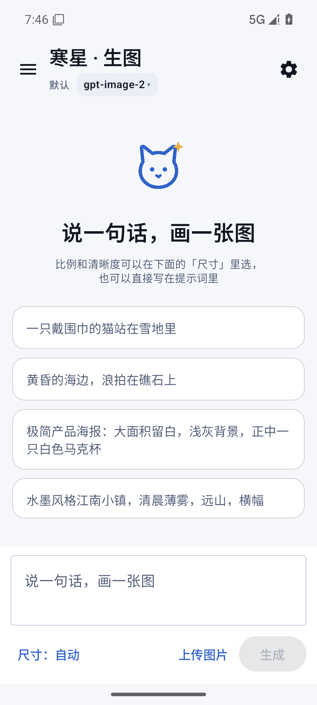
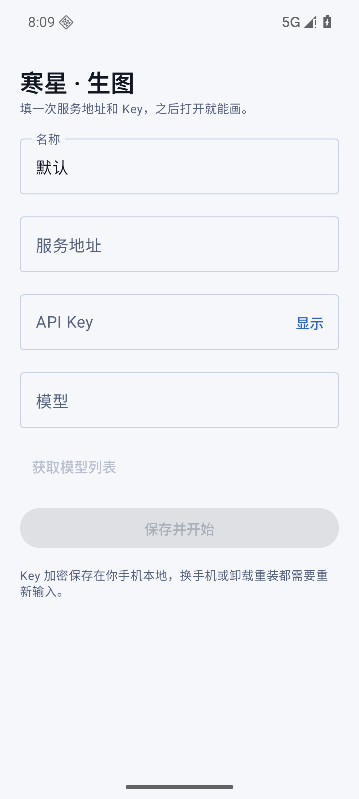

# 寒星生图 · Hanxing Image

一个 Android 原生的 AI 生图客户端，Kotlin + Jetpack Compose 编写，不走 WebView。它不内置模型，也不带任何服务商或 Key——你需要自备一个兼容 OpenAI Images API 的 Key，首次打开填一次才能用。

<p align="center">
  
</p>

## 下载

不想自己编译的话，直接下 APK：[最新版本 Releases](../../releases/latest)（Android 10 及以上）。

## 首次使用：先准备一个 Key

**这个应用不是打开即用的。** 它本身不提供模型，也不送额度；你需要先有一个**兼容 OpenAI Images API** 的服务（官方 API、自建服务或第三方中转都可以），把服务地址和 Key 填进去才能开始画。

<p align="center">
  
</p>

首次打开就是上面这个配置页，要填四项：

1. **服务地址**：填到 `/v1` 为止，例如 `https://your-host/v1`。应用会在后面拼 `/models`、`/images/generations`、`/images/edits`。
2. **API Key**：服务商发给你的 Key，请求时放在 `Authorization: Bearer` 里；只会加密存在本机。
3. **模型**：点「获取模型列表」从 `/v1/models` 里选；拉不到也可以直接手填模型名。
4. **名称**：随便起，用来区分多条配置。

保存后才会进入生图界面。生图费用由你使用的服务商收取，本应用不代收、也不提供任何额度。

> 注意：只支持 **Images 接口**，不是 Chat Completions。服务必须实现上面三个端点，并且生图响应返回 `b64_json`——只返回图片 URL 的实现不能直接用。

## 特性

- **自带 Key（BYOK）**：不内置任何服务商、中转地址或模型名。首次打开自己填服务地址和 Key，模型从 `/v1/models` 实时拉取，也可以手填。
- **数据只在手机**：对话、图片全部存在应用私有目录；Key 用 Android Keystore 加密（AES-256-GCM），不上传任何第三方服务器，也没有统计和埋点。
- **不偷偷写相册**：出图只落应用私有目录，点「保存」才写入 `Pictures/寒星生图`；删除对话只清私有目录，相册里已保存的副本永远不动。
- **多对话并行**：每个对话最多一张在生成，全局最多 3 张；各自有独立进度与取消，切对话、新建对话都不会被正在生成的任务拦住。
- **聊天式记录**：旧图在上、新图在下；进入对话停在最新一张，生成完成自动跟到底部。
- **参考图改图**：从相册选一张图作为参考，走 `/v1/images/edits`；提示词没写尺寸时沿用参考图尺寸。
- **前台服务保活**：生成在应用级协程里跑，切后台、锁屏、转屏都不中断；通知栏显示「正在生成 N 张 · 最久 mm:ss」。
- **图片预览**：点击全屏，双指缩放（1–6×）、拖动、双击放大/还原，返回键关闭。
- **主题**：星蓝 / 极光紫 / 青黛 / 暖金 四套强调色 × 深色 / 浅色 / 跟随系统。
- **多配置**：可以存多条「地址 + Key + 模型」，随时切换。

## 兼容的接口

应用只依赖三个标准端点，`baseUrl` 由使用者填写（例如 `https://your-host/v1`）：

| 用途 | 请求 |
| --- | --- |
| 拉模型列表 | `GET {baseUrl}/models` |
| 生图 | `POST {baseUrl}/images/generations` |
| 改图 | `POST {baseUrl}/images/edits`（multipart） |

生图请求体为 `{model, prompt, size, n}`，响应按 OpenAI 的 `b64_json` 解析，边收边报进度。

尺寸规则：边长取 16 的倍数、长边 ≤ 3840、总像素 655,360–8,294,400；`16:9` 4K = 3840×2160，`1:1` 4K = 2880×2880。只写「4K」不写比例时按 16:9 处理。

## 构建

环境要求：

- JDK 21
- Android SDK：`compileSdk 37`（需安装 `platforms;android-37.2`）、`build-tools 36.0.0`
- Gradle 9.6.0（仓库自带 wrapper）

```bash
# macOS / Linux
./gradlew :app:assembleDebug

# Windows
gradlew.bat :app:assembleDebug
```

产物在 `app/build/outputs/apk/debug/app-debug.apk`。也可以直接用 Android Studio 打开本目录。

## 签名

仓库不含任何签名材料。要出正式包，自己生成一个 keystore：

```bash
keytool -genkeypair -v -keystore keystore/release.jks \
  -alias hanxing -keyalg RSA -keysize 4096 -validity 10950
```

然后在根目录放 `keystore.properties`：

```properties
storeFile=keystore/release.jks
storePassword=你的密码
keyAlias=hanxing
keyPassword=你的密码
```

`keystore/`、`keystore.properties`、`*.jks` 都已在 `.gitignore` 里，不会被提交。

> 正式包和调试包签名不同，不能互相覆盖安装。换签名前先想清楚：卸载会清空应用内的对话、图片和配置。

## 隐私

- API Key 用 Android Keystore 里的密钥加密后存进 SharedPreferences，密文只在应用私有目录；卸载或换机后无法恢复，需要重填。
- 除了你填的那个服务地址，应用不会向任何其他服务器发请求。
- 没有账号体系、没有云同步、没有广告 SDK、没有统计 SDK。
- 删除图片只是移到应用私有目录的回收站，7 天后随启动清理；相册中的副本不受影响。

## 项目结构

```text
app/src/main/java/cn/hanxing/image/
  MainActivity.kt          单 Activity，edge-to-edge，首次进入请求通知权限
  HanxingApp.kt            Application：持有应用级 GenerationEngine 单例
  GenerationEngine.kt      生成引擎：生图/改图跑在应用级协程，界面销毁不中断
  GenerationService.kt     前台服务（dataSync）：生成期间保活 + 进度通知
  AppViewModel.kt          状态壳：配置 / 模型 / 参考图；生成委托给引擎
  data/Models.kt           配置、对话、记录、比例与清晰度、尺寸换算
  data/ConfigStore.kt      Keystore AES-256-GCM 加密配置
  data/ImageApi.kt         OkHttp：/models、/images/generations、/images/edits
  data/ImageStore.kt       私有目录 + JSON 索引 + 软删除回收站
  data/GallerySaver.kt     只往相册写入新图，从不删改相册
  ui/Theme.kt              四套强调色 × 深色/浅色/跟随系统
  ui/App.kt                主界面、设置页、卡片、尺寸面板
  ui/BrandMark.kt          品牌标（猫脸 + 四角星，纯 Canvas 绘制）
tools/mock-image-server.py 本地 mock 接口，跑 UI 流程用
```

## 已知限制

- 只支持 Android 10（API 29）及以上。
- 4K 出图在部分网关下很慢（PNG + 单连接限速），这是上游问题；应用已支持选择 JPEG，但需要网关认 `output_format` 参数。
- 未开启 R8 / 资源压缩，APK 约 25 MB。

## 许可证

[MIT](LICENSE) © 2026 ciyewuxue
